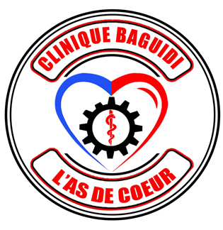
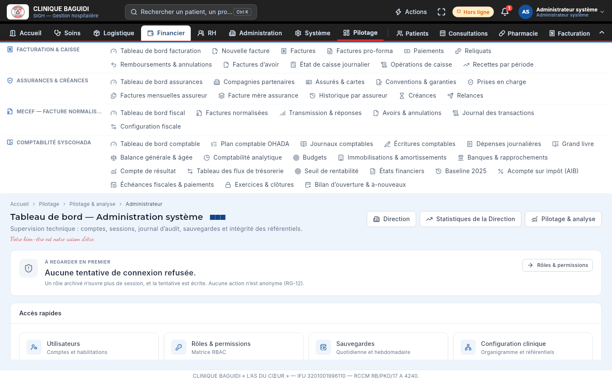
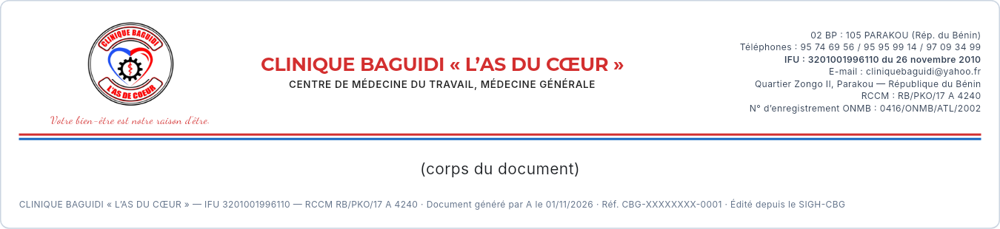
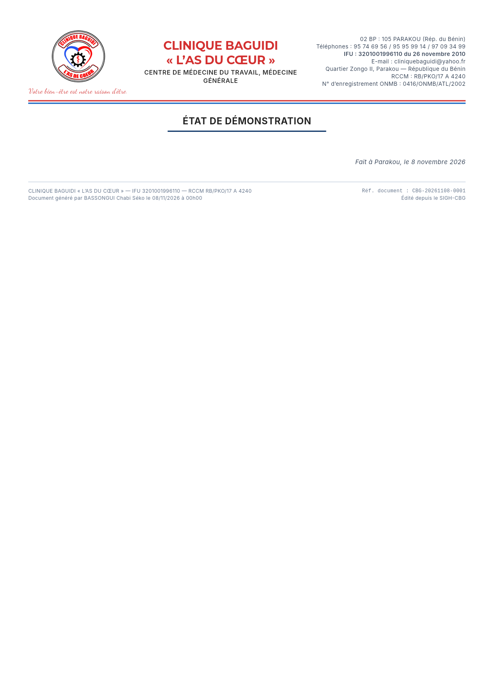

# SIGH-CBG

**Système Intégré de Gestion Hospitalière** 
Clinique Baguidi « L'As du Cœur » · Parakou, Bénin

*Votre bien-être est notre raison d'être.*

---

## Le projet

SIGH-CBG est un logiciel de gestion hospitalière conçu pour la Clinique Baguidi « L'As du Cœur ». Il remplace un parc d'outils cloisonnés (stocks, caisse, dossiers, comptabilité, paie, papier) par **un seul logiciel** qui suit un acte de bout en bout : le patient est reçu, consulté, prescrit, facturé et encaissé ; l'écriture comptable, la sortie de stock et la paie qui en découlent suivent d'elles-mêmes.

Il est pensé pour **continuer à travailler sans connexion** : chaque poste est autonome et les données se rejoignent ensuite par synchronisation chiffrée.

## Fonctionnalités principales

### Accueil et soins
Dossier patient avec identifiant unique, rendez-vous et consultations, imagerie médicale, hospitalisation et bloc opératoire, maternité et naissances, laboratoire et banque de sang.

### Pharmacie et achats
Stocks gros, détail et urgence, lots à péremption (FEFO), inventaires, besoins, commandes, livraisons et factures fournisseurs, sans jamais de stock négatif.

### Facturation et finances
Facturation et caisse avec prise en charge des assurances, factures normalisées MECeF, créances, comptabilité SYSCOHADA avec états financiers, échéances fiscales et retenue AIB.

### Ressources humaines et paie
Personnel, planning, évaluations, primes, bulletins de paie et cotisations.

### Administration et pilotage
Rôles et permissions par profil, journal de toutes les actions, courriers, ambulance, tableaux de bord par poste, rapports et états officiels.

### Modulable
Un module que la clinique n'exerce pas se ferme en un geste : il disparaît du menu et de la recherche, sans rien supprimer.

## Pièces imprimées à l'identité de la clinique

Chaque document édité (facture, ordonnance, bulletin, état comptable) reprend automatiquement l'en-tête officiel : logo et devise, dénomination, coordonnées et identifiants légaux, sous un double filet rouge et bleu.

  

## Contact

Pour toute utilisation commerciale : **[rarhodes06@gmail.com](mailto:rarhodes06@gmail.com)**

Clinique Baguidi « L'As du Cœur » · 02 BP : 105 Parakou (Rép. du Bénin)

